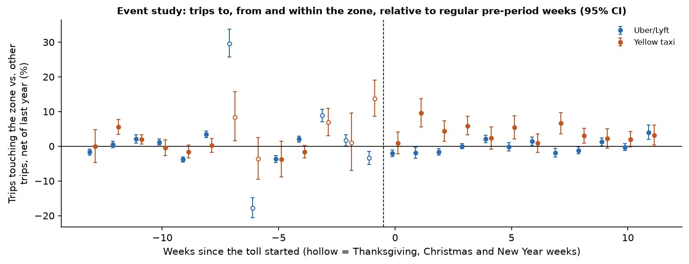
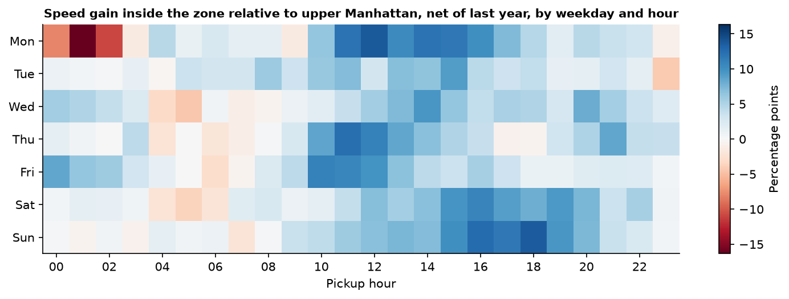
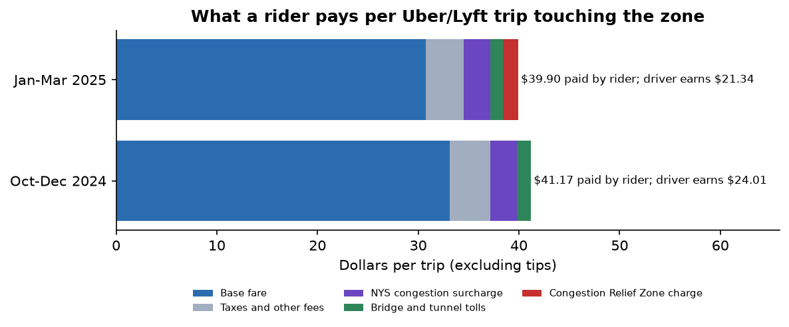
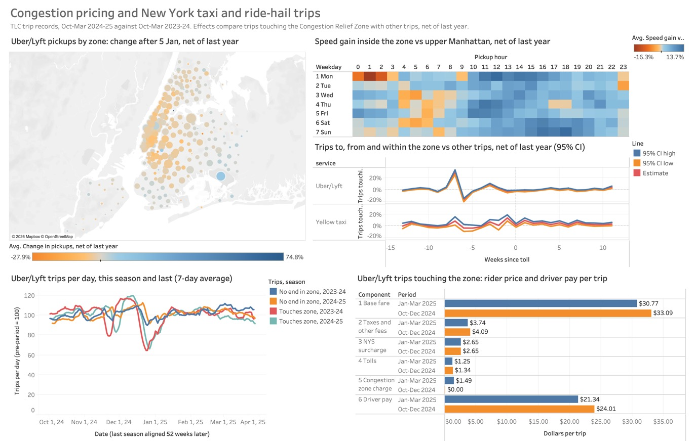

# Congestion Pricing and New York Taxi and Ride-Hail Trips

**How did Manhattan's congestion toll change trips, speeds, fares and driver pay inside and outside the zone?**
New York started charging vehicles entering Manhattan south of 60th Street (the Congestion Relief Zone) on
5 January 2025; Uber/Lyft riders pay $1.50 and yellow taxi riders $0.75 per trip to, from, within or through the
zone. This project cleans 271 million TLC trip records (Oct-Mar 2024-25 and the same months a
year earlier), and estimates the toll's effect with a difference-in-differences design that uses last year as the
seasonal baseline. Written for a ride-hail operator setting prices and driver incentives.

**Tools:** SQL (DuckDB over 24 Parquet files, window functions) · Python (pandas, linearmodels, statsmodels,
GeoPandas) · Statistics (difference-in-differences with flow and week fixed effects, event study, placebo test,
clustered and Newey-West standard errors) · Excel (unit economics and toll scenarios) · Tableau (zone map,
heatmap, event study)



## Findings

1. **Ride-hail demand for zone trips barely moved.** Uber/Lyft trips to, from and within the zone changed by -0.7% relative to trips with no end in the zone, net of last year's seasonal change (95% CI -1.5% to +0.2%). The interval includes zero. For scale, the MTA reports 11% fewer vehicles entering the zone in the toll's first year: ride-hail trips pay a $1.50 charge, not the $9 car toll, so their volume fell far less.
2. **Trips inside the zone got faster.** Uber/Lyft trips with both ends in the zone sped up 4.2% relative to trips inside Manhattan north of 60th Street, net of last year (95% CI +2.6% to +5.8%); average speed went from 8.1 to 9.0 mph. Yellow taxis show the same gain (4.8%). The gain is 5.1 points in tolled peak hours against 1.1 overnight.
3. **Riders paid $0.61 more per zone trip, not $1.50.** The zone charge added $1.45 per trip, but base fares fell $0.72 relative to other trips (net of last year), because faster trips take less time and both Uber/Lyft fares and TLC driver-pay rules include a per-minute component.
4. **Drivers earned less per trip but more per hour.** Driver pay per zone trip fell $0.55 (-$0.65 to -$0.45), while pay per hour on trip rose $0.92 (+$0.72 to +$1.12) from a base of $60 per hour.
5. **Yellow taxis: no clear change in zone trips.** The estimate is +2.0% (95% CI +0.3% to +3.6%), but a placebo start date in December gives +2.1%, so this is not evidence of riders switching to the cheaper $0.75 taxi charge.
6. **A single-season before/after comparison would mislead.** Comparing Jan-Mar 2025 with Oct-Dec 2024 alone puts the speed gain at 8.8% (double the estimate net of last year) and fails a placebo test (-13.4% 'effect' at a fake start date), because Manhattan's holiday season moves zone trips differently. Using Oct-Mar 2023-24 as the seasonal baseline fixes this: the placebo gives +0.7% (p = 0.13).





## Recommendations

1. Do not cut Uber/Lyft fares to offset the zone charge: zone trip volume held up, and riders' net price rose by less than half the charge because faster trips cost less.
2. Use the faster zone trips in driver supply messages: pay per hour on zone trips rose, so zone-specific driver bonuses are not needed to keep supply.
3. Review the time-based part of the fare and driver pay formulas: faster trips cut base fares by about $0.72 per zone trip.
4. Refresh the analysis as TLC publishes new months (about two months' delay) and watch the event study for a delayed demand response.

## Deliverables

| Deliverable | Where |
|---|---|
| Tableau dashboard: zone map, speed heatmap, event study, daily trips, price per trip | `dashboards/tableau/congestion_pricing_impact.twbx` |
| Excel model: unit economics before and after, toll scenarios with the measured price response (-0.44) | `excel/trip_unit_economics.xlsx` |
| Analysis notebook with outputs | `notebooks/congestion_pricing_analysis.ipynb` |
| One-page memo | `reports/memo.md` |
| SQL: Parquet view, cleaning rules, aggregates, panels | `sql/` |
| Result tables and figures | `reports/tables/`, `reports/figures/` |



## How it works

1. **Cleaning** (`sql/02-04`): one DuckDB view reads the 24 monthly Parquet files in place
   (283.8 million rows). Rules drop trips outside the study windows, under a minute or over three
   hours, with zero or 100+ miles, implausible speeds, unknown zones or non-positive fares; 95.5%
   of rows pass ([`docs/data_quality_log.md`](docs/data_quality_log.md)). Kept trips are aggregated in one pass to
   season x service x date x hour x pickup zone x trip group.
2. **Trip groups**: the MTA's list of the 38 taxi zones inside the Congestion Relief Zone sorts every trip
   into within, into, out of, upper Manhattan, or elsewhere. In Jan-Mar 2025, 99.5% of
   Uber/Lyft trips within the zone carry the charge, against 2.1% of trips elsewhere
   (trips passing through), which confirms the grouping.
3. **Design** (`src/did.py`): each flow (pickup zone x trip group) is compared with the same week a year earlier
   (weeks aligned 52 weeks apart), then flows touching the zone are compared with other flows before and after
   5 January: flow and week fixed effects, weights by pre-period volume, standard errors clustered by pickup zone.
   Thanksgiving falls in different weeks in the two seasons, so those two weeks are left out of the main estimate.
4. **Checks**: event study by week, a placebo start date in December, all-weeks and unweighted versions, and the
   naive single-season design for comparison. Regular pre-period weeks stay within 3.8% of their average
   for Uber/Lyft; holiday weeks move more, so effects of a few percent cannot be separated from weekly noise.
5. **Speeds**: daily distance-weighted speed inside the zone against upper Manhattan, as a year-over-year
   difference, regressed on the post period with Newey-West standard errors.
6. **Business tools**: Excel unit economics and toll scenarios (formulas over pasted results); Tableau workbook
   generated by `src/tableau_workbook.py` with Hyper extracts.

Details: [`docs/methodology.md`](docs/methodology.md) · data dictionary: [`docs/data_dictionary.md`](docs/data_dictionary.md)

## Run it

```bash
python -m venv .venv && source .venv/bin/activate
pip install -r requirements.txt
make all        # download 6.6 GB of Parquet, build the warehouse, run the analysis, notebook and tests
```

## Project structure

```
├── data/                 raw/ and processed/ (git-ignored); README with sources
├── sql/                  DuckDB SQL: zones, Parquet view, quality rules, aggregates, panels, unit economics
├── src/                  pipeline: data, DiD, figures, zones, Excel, Tableau, report
├── notebooks/            executed analysis notebook
├── excel/                trip unit economics and toll scenarios
├── dashboards/tableau/   .twbx workbook, CSV extracts, preview
├── reports/              results.json, memo, figures, tables
├── docs/                 methodology, data dictionary, data quality log
└── tests/                pytest suite
```

## Data

* NYC Taxi & Limousine Commission, [TLC Trip Record Data](https://www.nyc.gov/site/tlc/about/tlc-trip-record-data.page):
  yellow taxi and high-volume for-hire (Uber, Lyft) trips, Oct 2023-Mar 2024 and Oct 2024-Mar 2025, plus the taxi
  zone lookup and zone shapefile.
* MTA, [Central Business District Taxi Zones](https://data.ny.gov/d/yfdc-w5jh) (data.ny.gov dataset yfdc-w5jh).
* Charges: MTA, [Taxis and For-Hire Vehicles](https://www.mta.info/fares-tolls/tolls/congestion-relief-zone/taxi-fhv-tolls).
  Vehicle reduction for comparison: MTA press release, 5 January 2026.

Raw files are downloaded by `make data` and are not stored in this repository.

## Assumptions and limits

* Trips are classified by pickup and dropoff zone. Trips that pass through the zone without stopping pay the
  charge but count as "elsewhere", which slightly dilutes the estimates.
* The design assumes that, without the toll, zone and non-zone trips would have changed from autumn to winter as
  they did a year earlier. Other changes between the two years that hit zone trips differently would bias the result.
* Speeds are trip averages (distance / time), not road-segment speeds.
* Driver pay is reported for Uber/Lyft only. Tips are excluded from rider totals.
